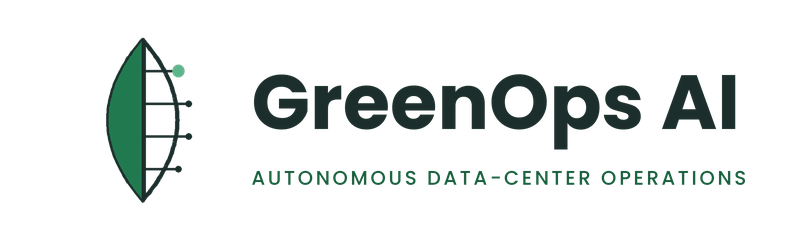
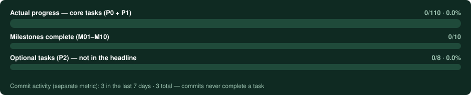
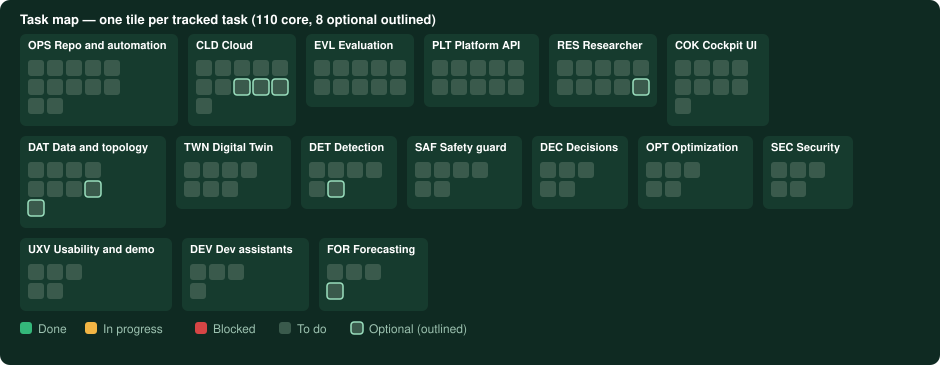
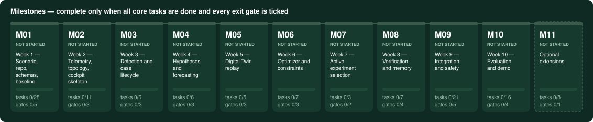

  

  By <b>SYNTRIX</b> · Competition prototype · Hybrid AI for data-center operations

> **Prototype.** GreenOps AI is a competition prototype. It uses synthetic, replayed, estimated or simulated inputs, labels them as such, performs **no production control**, and claims **no measured savings**. The repository is at the **planning and skeleton stage**: no feature is complete until it is implemented, tested and documented.

---

## Project Overview

GreenOps AI is a hybrid AI platform for intelligent data-center operations. It connects operational visibility, diagnosis, forecasting, optimization, Digital Twin experimentation and evidence-backed decision support in **one workflow** for data-center operators.

It is not only a monitoring dashboard, a workload scheduler or a static Digital Twin. Its defining experience is a continuous **Operating Researcher**: a bounded, deterministic orchestrator that notices meaningful operational situations, investigates them with competing hypotheses, tests alternatives in a safe virtual environment (the Digital Twin sandbox), and hands the operator a reviewable **Decision Certificate**. Autonomy is limited to observing, investigating, experimenting in the sandbox and recommending — high-impact production execution stays blocked.

Every metric carries a **provenance label** — `MEASURED`, `REPLAYED`, `ESTIMATED` or `SIMULATED` — and a deterministic **Local Safety Guard**, independent of any LLM, keeps working without cloud connectivity.

## Project Vision

Give data-center operators a single place where they can understand what is happening, find out why, safely test what to do about it, and make decisions they can justify — with every assumption, uncertainty and limitation visible, and without trading safety for autonomy.

## Target Users

| User | Need |
|---|---|
| Data-center operator / operations engineer | Understand the current state, investigate issues, compare options, decide |
| SRE / infrastructure reliability team | Understand performance and SLA risk, resource pressure and dependencies |
| Capacity planner | Explore demand trends, capacity constraints and placement alternatives |
| Energy / facilities manager | Understand energy and thermal context and evaluate trade-offs |
| Economic buyer: cloud or colocation operations manager | Improve efficiency, visibility, consistency and decision quality while managing risk |

## Core Features

The MVP shows a coherent end-to-end experience through **one working vertical slice** — a workload-imbalance / thermal-pressure case from telemetry to Decision Certificate — with some capabilities delivered at lower depth.

| Capability | What the MVP demonstrates | Boundary |
|---|---|---|
| Unified operations cockpit | Topology, workloads, utilization, capacity, performance, energy, temperature, alarms, data quality | Representative environment, clear operator workflow |
| Telemetry and topology | Import and validation of metrics, asset relationships and provenance | CSV and trace replay plus practical adapters |
| Anomaly and situation detection | Persistent pressure, imbalance, hot spots, improvement opportunities | Transparent rules and statistics first; ML only where it adds value |
| Root-cause investigation | Evidence correlated across workload, resource, power, temperature and topology | Structured hypotheses; abstains when data is insufficient |
| Forecasting and capacity awareness | Workload trends, resource pressure, capacity and SLA risk | Baseline model compared with simple baselines |
| Energy and thermal intelligence | Energy and thermal context and trade-offs | Estimated or simulated values, labelled; cooling stays advisory |
| Workload and resource optimization | Explainable candidate placements under compute, memory, SLA, energy and thermal constraints | No unrestricted production migration |
| Digital Twin scenario lab | Workload replay and baseline-versus-candidate what-if comparisons | Everything stays in the sandbox |
| Continuous Operating Researcher | Discover cases, gather evidence, compete hypotheses, choose experiments, verify, remember | Bounded by budgets, policies and simulation-only execution |
| Decision and governance | Recommendations with rationale, evidence, uncertainty, constraints and a Decision Certificate | A human operator reviews and authorizes any real change |
| History and learning | Search past cases, reuse results, record where findings do not apply | Memory never silently changes production policy |

## Project Scope

**Included in the MVP:** the connected cockpit; data import and topology; anomaly and situation analysis; evidence-based diagnosis; forecasting; optimization; energy and thermal awareness; Digital Twin what-if experiments; the Operating Researcher; operator-facing recommendations; decision history; audit trail; a complete demonstrator workflow.

**Safety boundaries:** no direct control of chillers, CRAC/CRAH units, UPS, switchgear or power distribution; no autonomous server shutdown or reboot; no unrestricted production workload migration; cooling suggestions are advisory; no measured production savings are claimed from simulation. These boundaries define how the features are demonstrated safely — they do not remove them.

## Goals

The project aims to improve the data-center operations experience and **measures** whether it does; no numerical performance, energy-saving, accuracy or cost-reduction result is promised in advance. Three systems — A (traditional baseline), B (GreenOps AI without the Researcher) and C (full) — run on identical traces, seeds, constraints and disclosed budgets, with ablations.

| Evaluation dimension | Question |
|---|---|
| Operational visibility | Can an operator understand assets, workload, capacity, performance, energy, thermal context and data quality? |
| Detection usefulness | Are meaningful anomalies surfaced and noisy cases controlled? |
| Diagnosis quality | Do hypotheses match known scenario causes (correct, incorrect, inconclusive)? |
| Forecast usefulness | How do forecasts compare with simple baselines, and where are they unreliable? |
| Optimization feasibility | Do candidates respect capacity, SLA, performance, energy and thermal constraints? |
| Digital Twin usefulness | Is it repeatable, comparable and honest about model mismatch? |
| Researcher contribution | Does C add value beyond B on at least one pre-registered metric, without unacceptable regression? |
| Operator experience | Does the Decision Certificate support review? |
| Safety and resilience | Are unsafe actions blocked and does local safety survive cloud loss? |
| Commercial viability | Does the workflow fit, and what are the deployment and integration burdens? |

## Tech Stack

| Area | Technology | State |
|---|---|---|
| Backend | Python, FastAPI (modular monolith) | Skeleton |
| Operator UI | React, TypeScript (Vite) | Skeleton |
| Structured data | PostgreSQL | Planned |
| Containers | Docker, Docker Compose | Generated, not yet built or run |
| Contracts | JSON Schema (seven versioned contracts) | Drafted, tested |
| Digital Twin | Simplified power and thermal model; simulator foundation (build or adopt) to be decided | Planned |
| Detection, forecasting, optimization | Transparent rules and statistics first; ML only where justified | Planned |
| Safety Guard | Deterministic, deny-by-default validators | First draft |
| Testing | pytest, TypeScript type-check and build | Partly in place |
| Automation | GitHub Actions, Python tracking scripts | Generated |

**Huawei Cloud services** — each is labelled *implemented*, *planned* or *optional*; none is implemented yet. **Planned:** ECS (hosting), RDS for PostgreSQL (structured data), OBS (traces, outputs, reports), IAM / CTS (access and audit), AOM / Cloud Eye (monitoring, where available). **Optional:** ModelArts, MaaS / Pangu models, CCE, DCS, CodeArts Agent (development support only). A local container fallback is kept.

## Project Progress

Actual progress is computed from the task statuses in [`TRACKING.md`](TRACKING.md). Commit activity is shown separately and never counts as progress. This section is refreshed automatically after every successful push to `main` in the upstream repository.

<!-- PROGRESS:START -->

**Actual progress:** 0 of 110 core tasks done (0.0%). Optional tasks: 0 of 8.

**Commit activity** (separate metric): n/a — computed on GitHub.

Progress by work area

| Work area | Done | Total | Core done |
|---|---:|---:|---:|
| PLT · Platform & API | 0 | 10 | 0% |
| DAT · Telemetry, Topology & Data | 0 | 9 | 0% |
| COK · Operations Cockpit | 0 | 9 | 0% |
| DET · Anomaly & Situation Detection | 0 | 6 | 0% |
| FOR · Forecasting & Capacity | 0 | 4 | 0% |
| RES · Operating Researcher | 0 | 10 | 0% |
| TWN · Digital Twin Scenario Lab | 0 | 7 | 0% |
| OPT · Workload & Resource Optimization | 0 | 5 | 0% |
| DEC · Decision & Governance | 0 | 5 | 0% |
| SAF · Safety Guard | 0 | 6 | 0% |
| EVL · Evaluation | 0 | 10 | 0% |
| CLD · Cloud & Packaging | 0 | 11 | 0% |
| DEV · AI Development Assistants | 0 | 4 | 0% |
| SEC · Security & Data Protection | 0 | 5 | 0% |
| OPS · Repository, Automation & Docs | 0 | 12 | 0% |
| UXV · Usability & Demo | 0 | 5 | 0% |

Progress by owner

| Owner | Done | Total | Core done |
|---|---:|---:|---:|
| Member 1 — Platform & Data — backend, ingestion, data model, APIs, safety guard, cloud packaging | 0 | 59 | 0% |
| Member 2 — Intelligence & Research — detection, forecasting, optimizer, Operating Researcher, evaluation | 0 | 34 | 0% |
| Member 3 — Digital Twin & Product — simulation, visualization, operator workflow, validation and demo | 0 | 25 | 0% |

<!-- PROGRESS:END -->

## Milestones

Milestone status is computed from the associated tasks and exit gates in [`TRACKING.md`](TRACKING.md).

<!-- MILESTONES:START -->

A milestone is complete only when all of its core tasks are done **and** every exit gate is ticked. The ten gates are indicative checkpoints, not promised dates.

| Milestone | Name | Status | Tasks | Gates |
|---|---|---|---:|---:|
| M01 | Week 1 — Scenario, repo, schemas, baseline | not started | 0/28 | 0/5 |
| M02 | Week 2 — Telemetry, topology, cockpit skeleton | not started | 0/11 | 0/3 |
| M03 | Week 3 — Detection and case lifecycle | not started | 0/6 | 0/3 |
| M04 | Week 4 — Hypotheses and forecasting | not started | 0/6 | 0/3 |
| M05 | Week 5 — Digital Twin replay | not started | 0/5 | 0/3 |
| M06 | Week 6 — Optimizer and constraints | not started | 0/7 | 0/3 |
| M07 | Week 7 — Active experiment selection | not started | 0/3 | 0/2 |
| M08 | Week 8 — Verification and memory | not started | 0/7 | 0/4 |
| M09 | Week 9 — Integration and safety | not started | 0/21 | 0/5 |
| M10 | Week 10 — Evaluation and demo | not started | 0/16 | 0/4 |
| M11 | Optional extensions | not started (optional) | 0/8 | 0/1 |
<!-- MILESTONES:END -->

## Definition of Done

A **task** is done when it is implemented as specified, its tests pass, another team member has reviewed it, documentation (and contracts or ADRs, if affected) is updated, no secrets or customer data were added, and its status is set to `done` in `TRACKING.md` in the same pull request. A **milestone** is complete when every core task assigned to it is done, every exit gate is ticked with evidence, and its flow has been run end to end. Features need to work across their agreed interface, and simulated, estimated and replayed results are never presented as measured.

## Risks & Assumptions

**Key risks:** the MVP becomes too broad for a small team · the Digital Twin does not represent reality accurately · incomplete or poor telemetry · incorrect LLM-generated explanations · the Researcher consuming too much time or compute · unsafe operational recommendations · competitors already offering similar capabilities · Huawei Cloud services unavailable or costly in the target region · a three-person team bottleneck.

**Mitigations in the design:** an integrated vertical slice; replay and simulation for unavailable feeds; data-quality gates and abstention; structured outputs with deterministic validators; investigation budgets and stop conditions; a Local Safety Guard and blocked high-impact execution; edition-specific competitor and prior-art review; early cloud readiness checks with a local fallback; module ownership, API contracts and integration checkpoints.

**Assumptions:** the competition prototype uses synthetic, replayed, estimated or simulated inputs; simplified power and thermal models are acceptable if assumptions are visible; Huawei service availability, quotas and pricing are still to be confirmed; the differentiation claim must still be checked against current competitor editions and prior art; the value proposition is validated with prospective users rather than supported by invented savings.

## Documentation

[`TRACKING.md`](TRACKING.md) (tasks, owners, milestones) · [`setup.md`](setup.md) (development setup) · [`docs/`](docs/) (architecture, methodology, ADRs, contributing, automation) · [`contracts/`](contracts/) (shared schemas)

## License

All rights reserved. Source is viewable for evaluation only; see [`LICENSE`](LICENSE).
